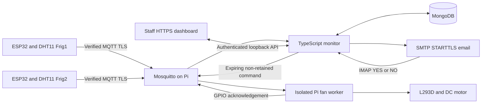

# Phase 2 — refrigeration and integrated hardware

Two ESP32 boards each read one DHT11. They publish exact topics **Frig1** and **Frig2** to Mosquitto on the Pi. The TypeScript subscriber persists measurements/settings, sends email alerts and processes replies. Staff use the HTTPS Razor dashboard; a separate Pi worker drives one shared motor.



Mosquitto routes messages; the TypeScript application, not the broker, writes the database. The original `phase2-architecture.png` is a historical planning sketch; this diagram describes the implementation.

## Required behavior

- Four gauges: temperature and humidity for each fridge.
- Separate persisted thresholds, initially 8 °C.
- A fresh over-threshold reading queues an email stating the current temperature and asking whether to turn on the shared fan.
- An exact first-line **YES** from the configured recipient, with the original subject/token, authorizes one command. **NO**, other text or no reply never starts the fan.
- Email/command outcomes are visible as persisted notifications. ON is shown only after a matching Pi output acknowledgement.
- OFF can preempt an ON awaiting confirmation. The dashboard is **not** an emergency stop.
- Delayed/missing data is stale, not a fresh measurement. Mail transport does not block the live control queue.

Replies expire, require fresh over-threshold telemetry, and cannot create a second actuation after restart. Pending, confirmed and failed command states are distinct. Inbox read/unread flags are not processing state; durable UID progress and per-message handling prevent older eligible replies being starved.

The assignment requires email approval. This preserves that workflow rather than replacing it with dashboard-only approval. **Residual risk:** provider-delivered From headers and possession of a private token are not cryptographic proof of the sender. Use a dedicated protected mailbox, do not expose approval material in logs, and isolate the lab network.

## Wiring — power off first

### Each ESP32/DHT11

| Connection | Wiring |
|---|---|
| VCC | 3.3 V-compatible DHT11/module → ESP32 3.3 V |
| GND | ESP32 GND |
| DATA | Each board's GPIO26 |
| Pull-up | 10 kΩ from DATA to 3.3 V unless already on the module |

Verify the actual pin ordering. Never pull an ESP32 input to 5 V. If a particular sensor requires 5 V, use a suitable level shifter. DHT11's limited accuracy/range is acceptable for the classroom simulation, not safety-critical refrigeration. A room-temperature demonstration threshold such as 20 °C is practical.

### Integrated Pi outputs

| Output | BCM GPIO | Physical pin |
|---|---:|---:|
| Blue success LED | 5 | 29 |
| Red failure LED | 6 | 31 |
| Buzzer transistor base through 1 kΩ | 22 | 15 |
| L293D EN1 | 27 | 13 |
| L293D IN2 | 17 | 11 |

**Relocate the old LEDs from BCM17/27 before enabling the new configuration.** LEDs need 220–330 Ω resistors and ground returns. Use the appropriate transistor/rated supply for the buzzer; never connect a Pi GPIO to 5 V.

Hold L293D IN1 LOW; connect OUT1/OUT2 to the motor. Use an appropriately rated external motor supply, common grounds and 10 kΩ enable pull-down. Verify driver logic supply, input levels, flyback protection and motor stall current. Never power the motor from a GPIO or use the Pi 5 V pin as its motor supply. Secure moving parts.

Real initialization is blocked until `FAN_WIRING_CONFIRMED=true`. Start with `FAN_SIMULATE=true`; change it to false only after inspection. Startup/disconnect/shutdown force OFF. Runtime uses a monotonic clock; repeated ON does not extend one continuous run. Preserve an independent physical cutoff for an OS freeze or stuck driver.

## Broker TLS and least-privilege identities

Install Mosquitto, `mosquitto-clients` and OpenSSL on the Pi. Use a stable DNS/mDNS name, for example the Pi's actual hostname `northstar-broker.local`; ensure it resolves on clients. Discovery identifies the location, **not** the broker's authority.

```bash
bash pi/provision-mqtt.sh northstar-broker.local /private/NEW-broker-bundle
sudo bash pi/install-mqtt.sh /private/NEW-broker-bundle
```

Provisioning creates a real private CA, server certificate with the chosen DNS name and localhost SANs, and distinct random role passwords. It does not install/start anything. The initial installer refuses to overwrite existing broker files. Keep `ca.key` offline; distribute only `ca.crt`. The server key belongs only to the broker.

Review `/etc/mosquitto/conf.d/`, remove old plaintext listeners and retire shared credentials, then explicitly restart Mosquitto. Only TLS8883 should be exposed to the sensor network. Do not retain a convenience plaintext listener.

| Identity | May publish | May subscribe/read |
|---|---|---|
| sensorFrig1 | Frig1 | Nothing |
| sensorFrig2 | Frig2 | Nothing |
| northstar-iot | store/fan/set | Frig1, Frig2, store/fan/status |
| northstar-fan | store/fan/status | store/fan/set |

`pi/mosquitto.acl.example` is deny-by-default. TLS alone does not limit a compromised sensor's authority; each identity must retain only its own permissions.

Services need `MQTT_URL=mqtts://localhost:8883`, `MQTT_CA_FILE=/etc/northstar/certs/ca.crt`, the configured `MQTT_SERVER_NAME`, and their own user/password. The fan connects using the certificate DNS name, so that name must resolve on the Pi too. Never set insecure TLS or disable hostname verification.

## Firmware

Use **Arduino ESP32 core 3.3.3 or newer** and the DHT sensor, Adafruit Unified Sensor and PubSubClient libraries. Copy `secrets.example.h` to the ignored `secrets.h`, fill 2.4 GHz Wi-Fi settings, each sensor's distinct credentials, the broker certificate DNS name, and the complete public CA PEM.

```bash
arduino-cli core install esp32:esp32@3.3.3
arduino-cli lib install "DHT sensor library" "Adafruit Unified Sensor" "PubSubClient"
bash firmware/flash-sensor.sh Frig1 /dev/ttyUSB0
bash firmware/flash-sensor.sh Frig2 /dev/ttyUSB1
```

Confirm physical board/port selection before uploading. Both use GPIO26. The boards need 2.4 GHz Wi-Fi, peer traffic, MQTT8883, and NTP time synchronization for certificate validity. The configured public NTP servers need network reachability; arrange a trusted local time source if the lab network cannot reach them. Never bypass certificate-date checks.

mDNS discovery uses `_northstar-mqtt._tcp.local` with `tls=1` and the matching `serverName`; allow multicast UDP5353. If multicast is unavailable, set the intended broker location in `MQTT_HOST`, keeping the same trusted certificate name. Firmware can verify the name even when connecting to the discovered address.

Every five seconds the board publishes non-retained QoS0 telemetry:

```json
{"temperature":22.0,"humidity":61.0,"sampleId":"9abc1234-17"}
```

`sampleId` is required for deduplication. Invalid DHT readings are not sent. QoS0 is appropriate for replaceable periodic sensor readings; command publication and GPIO acknowledgement have separate semantics.

## Isolated service installation

Build the web and IoT outputs, then:

```bash
dotnet publish src/SmartStore/SmartStore.csproj -c Release -o publish/web
npm --prefix iot-server ci
npm --prefix iot-server run build
sudo bash pi/install-services.sh --install
```

The installer uses system-wide runtimes, separate `northstar-web`, `northstar-iot`, `northstar-fan` users, read-only application files in `/opt/northstar/{web,iot,fan}`, and private writable state directories. It never enables or starts the fan.

Configure root-owned, role-readable `0640` files:

| File | Allowed secrets/settings |
|---|---|
| `/etc/northstar/web.env` | Web database identity, account SMTP, staff IDs, shared local API key, GPIO mapping, trusted proxy |
| `/etc/northstar/iot.env` | IoT database identity, northstar-iot MQTT credentials/CA/name, alert SMTP/IMAP, local API key |
| `/etc/northstar/fan.env` | Only northstar-fan MQTT credentials/CA/name, GPIO, simulation, cutoff and replay-state settings |

Fan never loads the project `.env` or a database/mail credentials file. Web/IoT use authoritative `NORTHSTAR_CONFIG_FILE`; a missing file is an error, not permission to load another role's fallback.

Use separate least-privilege database identities. Web needs its account/registry/inventory/sales/coupon/balance/email collections; IoT needs only refrigerator settings/readings/alerts/commands, mailbox progress, notifications and its email log. Grant collection-scoped reads/writes and required index creation, not deployment administration or access to other databases. The web's explicit migration operator additionally needs view/index migration privileges. Create/change Atlas roles using the tenant administrator, not the fan or application user.

The web backend binds only `http://127.0.0.1:5198` behind trusted HTTPS. Configure `pi/Caddyfile.example` and client CA trust, then explicitly allow only the actual proxy IP through `Security__TrustedProxies`. The local IoT API remains `127.0.0.1:3100` and requires a real shared key of at least 32 characters.

```bash
sudo systemctl enable --now mosquitto northstar-iot northstar-web
# After actual wiring/cutoff inspection and real-mode configuration only:
# sudo systemctl enable --now northstar-fan
```

Install `pi/requirements.txt` into the selected service Python. On Pi 5, use the OS libgpiod and gpio permissions; do not make device nodes world-writable.

## Email

See [EMAIL_SETUP.md](EMAIL_SETUP.md). Both applications use SMTP587 STARTTLS; IMAP uses993 TLS. The alert recipient replies from its configured address with YES or NO on the first nonblank line, preserving the subject.

The default cooldown and reply expiry are 15 minutes. Failed delivery retries no faster than once a minute while readings are fresh/hot. Retry text uses the latest temperature/threshold. Email cannot hold up live status/OFF handling. Approval is durably attached to one command before publication; acknowledgement/failure is recorded separately.

## Acceptance checks

Use an isolated broker/database and simulated GPIO first. Test correct CA/name and wrong CA/name, anonymous rejection and every denied cross-role topic—not merely a successful connection. Show that sensor credentials cannot publish fan commands.

```bash
python3 -m unittest discover -s pi -p test_fan_controller.py
npm --prefix iot-server test
npm --prefix iot-server run test:integration
bash -n pi/install-services.sh pi/provision-mqtt.sh pi/install-mqtt.sh firmware/flash-sensor.sh
# On Linux with published outputs and systemd-analyze:
bash pi/install-services.sh --check
```

Live demonstration still requires both flashed boards, real CA/DNS/time configuration, two changing measurements, saved thresholds after restart, a received alert, NO/no reply taking no action, YES plus actual motor movement, OFF during pending ON, safety cutoff, and sensor/worker disconnection indicators. Simulated GPIO proves none of the physical operations.

All members must participate. Complete the real-name task table in [README](../README.md#required-group-task-table); the repository cannot establish student assignments automatically.
