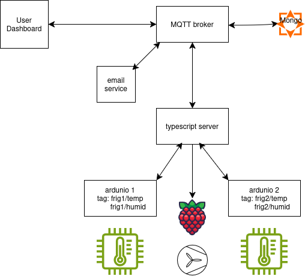
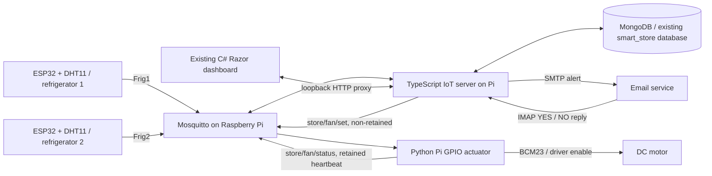

# Phase 2 — refrigeration monitoring lab

This extends the existing C#/.NET 8 customer registry, checkout, MongoDB and GPIO code. Open **`/Refrigerators`** from the store navigation. Phase 1 pages still work.

## Your diagram, implemented



The diagram's two “arduino” nodes are **ESP32 boards**, as required by the PDF. Each board has a DHT11. The labels `frig1/temp`, `frig1/humid`, etc. represent fields; the lab specifically requires the case-sensitive MQTT topics **`Frig1`** and **`Frig2`**, so each topic carries both fields in JSON.



Mosquitto is a message router, **not a database**: the TypeScript subscriber is the bridge that stores MQTT readings in MongoDB. The existing Razor app accesses that bridge through a server-side HTTP proxy; browsers do not receive database, MQTT or mailbox credentials. The Python worker is the Pi motor adapter to the TypeScript service. All three services can run on the same Raspberry Pi.

## Requirement checklist

| Phase 2 PDF requirement | Implementation |
|---|---|
| Two ESP32 boards, each with a DHT11 | `firmware/FridgeSensor/FridgeSensor.ino`, configured once as `Frig1`, once as `Frig2` |
| Raspberry Pi Mosquitto broker | `pi/mosquitto.conf.example` and setup below |
| Two MQTT topics | Exact `Frig1` / `Frig2`, JSON temperature + humidity every 5 seconds |
| Four gauges / own dashboard layout | `src/SmartStore/Pages/Refrigerators.cshtml`, custom CSS gauges and inline refrigerator/fan icons |
| Customizable threshold per refrigerator | Dashboard forms; MongoDB `fridge_settings` documents survive restart |
| Over-temperature email asking about fan | SMTP message: “The current temperature is X °C. Would you like to turn on the fan?” |
| YES reply starts fan; otherwise no action | IMAP polling, exact first-line YES, sender/alert token/expiry checks; NO never changes fan |
| Notification after sending email | Persisted `iot_notifications`, refreshed on dashboard every 3 seconds |
| Fan ON/OFF icon and motor following status | Pi driver output acknowledgements; no optimistic ON; rotating icon after confirmation |
| Pi controls DC motor through driver | `pi/fan_controller.py`, BCM23 to motor-driver enable |
| Group task description table / everyone participates | Template below; enter real names and demonstrate each member's work |

**Hardware installation, valid mailbox credentials and a live demonstration are still required.** Tests using a simulated GPIO output are not proof of a wired motor or successful external email delivery.

## 1. Wiring (power off first)

### Both ESP32 / DHT11 circuits

| Connection | Wiring |
|---|---|
| DHT11 VCC | ESP32 **3.3 V**, using a 3.3 V-compatible sensor/module |
| DHT11 GND | ESP32 GND |
| DHT11 DATA | ESP32 GPIO **4** |
| Pull-up resistor | **10 kΩ** from DATA to **3.3 V**, unless the module already includes one |

For a bare four-pin DHT11 viewed from its grille/front, verify the datasheet: commonly VCC, DATA, unused, GND left-to-right. Three-pin modules may use a different ordering; follow their labels. Never pull the ESP32 data input up to 5 V. If your sensor requires 5 V, use suitable level shifting instead of connecting its 5 V data line directly.

DHT11 typically measures **0–50 °C** with modest accuracy. It is adequate for this classroom demo, not safety-critical refrigeration or a below-freezing freezer. Use a threshold below room temperature (for example 20 °C) for the demo; 8 °C is the initial software default.

### Raspberry Pi / DC motor (example: L298N module)

The application uses **one shared fan**, matching the diagram and PDF's single motor. An approved alert from either refrigerator requests this fan.

| Connection | Wiring |
|---|---|
| L298N OUT1 / OUT2 | DC motor terminals |
| Motor supply | Separate supply appropriate for the motor and driver; follow the module's ratings |
| Driver logic supply | Follow the module's 5 V logic/regulator jumper instructions; do not backfeed Pi power |
| Driver GND | Common with motor supply GND and Pi GND (physical pin 6) |
| IN1 | Pi 3.3 V logic (physical pin 1), for fixed forward direction |
| IN2 | GND |
| ENA | **Remove ENA jumper**; connect Pi **BCM23 / physical pin 16** |
| Enable pull-down | **10 kΩ** from ENA to GND to keep motor OFF while Pi boots |

Use a module whose ENA accepts 3.3 V logic (L298N uses TTL inputs). Verify its flyback protection and ratings. **Never power a motor directly from a GPIO, never connect motor voltage to the Pi, and do not use the Pi's 5 V pin as the motor supply.** Secure exposed motor blades/shaft. Existing Phase 1 BCM17/27 LEDs and BCM22 buzzer are unchanged; BCM23 does not conflict.

The ON indicator confirms the Pi's GPIO driver output, not measured mechanical rotation. A disconnected/miswired motor cannot be detected without another sensor. Software stops the output on MQTT disconnect, graceful shutdown, reconnect and a configurable run timeout (default 5 minutes). A software process cannot guarantee safety if the OS freezes: use an appropriate driver pull-down and physical power cutoff.

## 2. Mosquitto on Raspberry Pi

Do not overwrite an existing broker setup blindly. Inspect `/etc/mosquitto/conf.d/` and avoid duplicate port-1883 listeners.

```bash
sudo apt update
sudo apt install -y mosquitto mosquitto-clients python3-venv python3-dev build-essential swig
sudo mosquitto_passwd -c /etc/mosquitto/northstar-passwords northstar
sudo chown root:mosquitto /etc/mosquitto/northstar-passwords
sudo chmod 640 /etc/mosquitto/northstar-passwords
sudo cp pi/mosquitto.conf.example /etc/mosquitto/conf.d/northstar.conf
sudo systemctl enable mosquitto
sudo systemctl restart mosquitto
sudo systemctl status mosquitto
```

Use the same MQTT password in root `.env` and both boards' `secrets.h`. Allow TCP1883 from the ESP32 boards on your private lab LAN. Do not expose this plaintext listener to the public Internet. Use broker TLS and access controls for deployment beyond a trusted classroom network.

## 3. Configure and start the software

Install **Node.js 20+**, **.NET 8 SDK**, and Python 3. Run commands from the repository root. On this machine, .NET is at `$HOME/.dotnet/dotnet`; add `$HOME/.dotnet` to PATH if needed.

```bash
cp .env.example .env
chmod 600 .env
# Edit .env with your MongoDB Atlas URI, broker password and mailbox settings.
# Do not put actual credentials in versioned files.
npm --prefix iot-server ci
npm --prefix iot-server run build
python3 -m venv .venv
.venv/bin/pip install -r pi/requirements.txt
dotnet restore SmartStore.sln
```

If `.env` does not include `MONGODB_URI`, the TypeScript service can also load `MONGODB_ENV_FILE` or this Pi's existing `/home/matt/Downloads/atlas-credentials.env`. The C# app supports the existing fallback as before. Explicit process environment variables win. Atlas must allow the Pi's public IP and grant the account `readWrite` on `smart_store` (see Phase 1 README).

Start these in **three terminals**, keeping the repository root as the working directory:

```bash
# Terminal 1: TypeScript MQTT / MongoDB / email service
npm --prefix iot-server start

# Terminal 2: real Pi output, after checking wiring
.venv/bin/python pi/fan_controller.py

# Terminal 3: existing store app plus refrigeration dashboard
ASPNETCORE_URLS=http://0.0.0.0:5198 dotnet run --no-launch-profile --project src/SmartStore
```

Open **`http://PI_IP:5198/Refrigerators`**. No sensor reading is fabricated: cards show waiting/offline until actual telemetry arrives. Readings older than 30 seconds are visibly stale. The TypeScript API listens only on `127.0.0.1:3100`. Keep `IOT_API_KEY` identical for both services. If you change `IOT_PORT`, also set `Iot__BaseUrl=http://127.0.0.1:NEW_PORT/` for C#.

For a non-hardware test, run the fan worker with **`FAN_SIMULATE=true`**. The dashboard explicitly labels SIMULATION. Do not leave this enabled for the physical lab demonstration. Real GPIO initialization failure stops the worker rather than pretending the motor is running. The user needs GPIO permissions (`sudo usermod -aG gpio "$USER"`, then sign out/in).

### Email setup

1. Use a dedicated SMTP/IMAP mailbox with provider-approved app passwords. Fill `SMTP_*`, `IMAP_*`, `SMTP_FROM` and **`ALERT_TO`** in `.env`.
2. SMTP port587 uses STARTTLS; port465 uses TLS. IMAP uses TLS on port993. Enable IMAP in the provider if required.
3. Set **`EMAIL_ENABLED=true`**, then restart the TypeScript service. The dashboard reports whether IMAP polling succeeds. Disabled/misconfigured delivery produces a notification; it never silently starts the fan.
4. Exceed a refrigerator's saved threshold. An email includes the temperature, fan question and an opaque alert ID in its subject.
5. Reply from the exact `ALERT_TO` address, retain the subject, and put **YES** by itself on the first nonblank line. Quoted text below it is fine. **NO**, other text or no reply does not turn the fan on.
6. Requests expire after 15 minutes. YES is ignored if the reading is stale or the temperature has recovered. Wrong-sender, unrelated, expired and already-processed replies are ignored. If the Pi is unavailable, a YES is left unread for retry until it expires.

Each refrigerator has a 15-minute email cooldown. SMTP failures retry no more than once per minute while the reading is fresh and still hot. Threshold changes never auto-start a motor. Fan ON commands are non-retained and expire after 15 seconds; the dashboard shows a pending command until matching Pi acknowledgement. The fan does not automatically stop on NO/recovery; use OFF or the safety timeout, as NO means “take no action.”

Mailbox polling trusts the configured provider's delivery and sender headers, not cryptographically signed replies. This and the existing unauthenticated store management/dashboard controls are a **classroom demo**, not a production access-control system. Keep it on a trusted LAN; add login/authorization, signed approvals and TLS before production. SMTP delivery is at-least-once across a crash between send and database update, so a rare duplicate email is possible.

## 4. Flash both ESP32 boards

```bash
cp firmware/FridgeSensor/secrets.example.h firmware/FridgeSensor/secrets.h
# Set WiFi, Pi LAN IP, broker user/password, and FRIDGE_TOPIC="Frig1".
arduino-cli core install esp32:esp32
arduino-cli lib install "DHT sensor library" "Adafruit Unified Sensor" "PubSubClient"
arduino-cli board list
arduino-cli compile --fqbn esp32:esp32:esp32 firmware/FridgeSensor
arduino-cli upload --fqbn esp32:esp32:esp32 --port /dev/ttyUSB0 firmware/FridgeSensor
```

Use your actual ESP32 board FQBN/serial port from `arduino-cli board list`. For the second board, change **only** `FRIDGE_TOPIC` to **`Frig2`**, then compile/upload to that board. In Arduino IDE, install the same ESP32 core/libraries and open `FridgeSensor.ino`. Serial output is 115200 baud. WiFi/MQTT reconnect automatically; failed DHT reads are not published.

Example on-wire data:

```json
{"temperature":22.0,"humidity":61.0,"sampleId":"9abc1234-17"}
```

Temperature is Celsius; humidity is percent RH. `sampleId` combines a boot ID and sequence to deduplicate repeated messages. Firmware publishes QoS0 every 5 seconds without retention. The service accepts simple temperature/humidity JSON for manual lab testing too, but without `sampleId` it cannot deduplicate retransmissions.

## Data storage

Existing `customers` / `demo_sales` collections are preserved. Added collections:

- `fridge_settings`: `_id: Frig1/Frig2`, `threshold`, seeded only if absent.
- `fridge_readings`: topic/fridge, temperature, humidity, receive time and unique sample ID; indexed per fridge/time; 30-day TTL.
- `fridge_alerts`: alert ID, fridge, temperature/threshold, recipient, email state, expiry and reply decision. IDs correlate email replies.
- `iot_notifications`: persisted alerts, delivery failures, replies, command requests and acknowledgements; latest 30 shown.

MongoDB outages prevent new telemetry/settings from being accepted; dashboard readings eventually go stale and service logs report failures. No settings or telemetry are silently replaced by fake in-memory production data.

## Tests and demonstration

```bash
dotnet test SmartStore.sln
npm --prefix iot-server run build
npm --prefix iot-server test
python3 -m unittest discover -s pi -p 'test_*.py' -v
# Requires mosquitto executable and Python paho-mqtt/python-dotenv on python3.
# Uses an isolated localhost broker and simulated GPIO; no real motor is activated.
npm --prefix iot-server run test:integration
```

If Python dependencies are only in `.venv`, prefix the integration command with `PATH="$PWD/.venv/bin:$PATH"`.

Lab demonstration (all group members participate):

1. Show both ESP32 circuits, Pi Mosquitto and the motor driver wiring.
2. Start services; show four independently changing gauges and timestamps.
3. Set different thresholds per fridge. Restart the TypeScript service and confirm saved thresholds persist.
4. Set a threshold below the measured temperature; show the actual received email and system notification. The motor must remain OFF before approval.
5. Reply **NO**; show that the motor does not start. For a new alert, wait the cooldown or temporarily shorten `ALERT_COOLDOWN_SECONDS` / `REPLY_EXPIRY_SECONDS` for the demo, then restart the service.
6. Reply **YES** to a fresh alert; show the pending request, ON icon, Pi confirmation notification and **physical motor running**. Select OFF; motor and icon must stop.
7. Disconnect a sensor; show stale/offline after 30 seconds. Disconnect the fan worker/broker; show unknown fan status and safe output behavior.
8. Show MongoDB documents and run automated tests. Restore the normal cooldown after testing.

### Task description table (fill with actual student names)

| Student | Assigned task | Files/components | Demonstration responsibility |
|---|---|---|---|
| _Name_ | ESP32 sensor acquisition and circuit wiring | `firmware/FridgeSensor/`, two DHT11 breadboards | Both topics and independently changing measurements |
| _Name_ | MQTT broker and MongoDB communication | `pi/mosquitto.conf.example`, `iot-server/src/repository.ts` | Broker messages, persisted readings and thresholds |
| _Name_ | Dashboard structure and presentation | `Pages/Refrigerators.*`, gauges CSS/JS, proxy | Four gauges, independent thresholds, stale status and notifications |
| _Name_ | Email alert/reply and fan integration | `iot-server/src/email.ts`, `monitor.ts`, `pi/fan_controller.py` | NO/YES behavior, real motor, fan acknowledgement and safety OFF |

## Optional boot services

The templates in `pi/systemd/` use this Pi's user `matt` and current repository path. **Review and edit User, WorkingDirectory and ExecStart for your installation.** `node` must resolve to Node20+ under systemd (use the absolute path from `command -v node`, not an interactive shell-only PATH). Do not enable services until the terminal setup works.

```bash
dotnet publish src/SmartStore/SmartStore.csproj -c Release -o publish/web
sudo cp pi/systemd/northstar-*.service /etc/systemd/system/
sudo systemctl daemon-reload
sudo systemctl enable --now northstar-iot northstar-fan northstar-web
journalctl -u northstar-iot -u northstar-fan -u northstar-web -f
```

Keep the root `.env` private but readable by the service user. Do not paste secrets into unit files, logs or commits.
