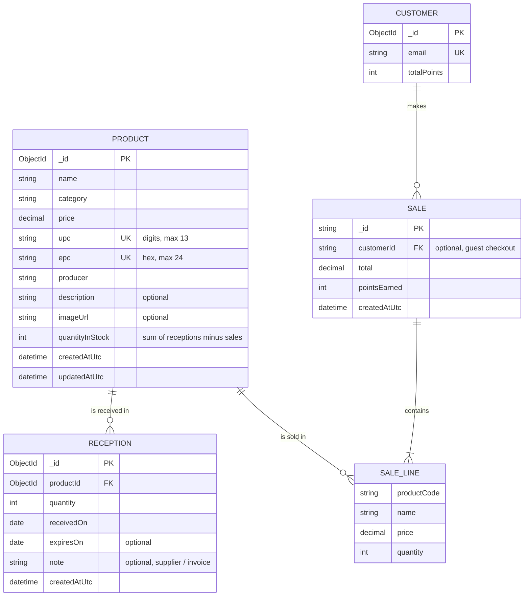

# Phase 3 — Product & inventory module

Owner: Jonathan. Covers registering, editing and deleting products, and receiving stock.

## Pages

| Page | URL | What it does |
| --- | --- | --- |
| Products | `/Products` | Product table with search (name, producer, or a scanned UPC/EPC), category filter, stock badges (green = OK, amber = 5 or fewer, red = out). Edit, Receive and Delete (with on-page confirmation) per row. |
| Add product | `/Products/Create` | Register a product once. New products start at 0 in stock and you're sent to Receive next. |
| Edit product | `/Products/Edit/{id}` | Change product details. Stock can't be typed in here; it only changes through deliveries and sales. |
| Receive stock | `/Products/Receive/{id?}` | Scan a UPC/EPC (or pick a product), enter quantity, date received, optional expiry and supplier note. Shows that product's delivery history; a delivery entered by mistake can be undone if its units haven't been sold. |

Every action shows a notification ("Product added successfully", "Received 24 × Coca-Cola. Stock is now 48.", etc.).

**Scanners:** the barcode scanner and the CF600 RFID reader (in keyboard mode) type the code and press Enter. On the product form, Enter in the UPC/EPC box moves to the next field instead of submitting early. In the search and lookup boxes, Enter searches.

## Database (MongoDB `smart_store`)



`CUSTOMER`, `SALE` and `SALE_LINE` are owned by the checkout and accounts work (Renz, Fahad) and are shown here only to make the relationships clear; they currently live in the `customers` and `demo_sales` collections.

Collections and indexes:

- `products` — unique indexes `ux_products_upc` and `ux_products_epc` (a code can't be registered twice), plus `ix_products_category`.
- `receptions` — `ix_receptions_product_receivedOn` on `(productId, receivedOn desc)`.
- Deleting a product also deletes its receptions.

Stock is stored on the product (`quantityInStock`) so checkout can read it in one lookup. It changes only through `ReceiveStockAsync` (adds) and `DecrementStockAsync` (removes, atomically, and refuses if there isn't enough).

## For the checkout team

Inject `IProductRepository` (already registered in `Program.cs`) instead of the hardcoded catalog in `StoreDemo`:

```csharp
var product = await products.FindByEpcAsync(scannedEpc, ct)   // RFID
           ?? await products.FindByUpcAsync(scannedUpc, ct);  // barcode
```

When the payment is approved, take the whole cart out of stock in one call. It's all or nothing: if any item is short, nothing is removed.

```csharp
// cart: product id -> quantity
var result = await products.DecrementStockManyAsync(cart, ct);
if (!result.Succeeded)
    throw new InvalidOperationException(result.Message); // e.g. "Not enough Whole Milk 2L in stock (1 left, 2 requested)."

try
{
    await sales.InsertOneAsync(sale, cancellationToken: ct);
}
catch
{
    await products.RestoreStockAsync(cart, CancellationToken.None); // sale not saved -> put stock back
    throw;
}
```

Don't call it for a declined payment.

- Use the product's **UPC as the cart code** (replaces `1001`–`1004`).
- **Each product has one EPC.** When the RFID reader sees the same EPC more than once in a single scan, that means more than one of that product, so count repeats as quantity rather than discarding them as duplicates.
- `GetAllAsync()` returns every product with its current `QuantityInStock`.
