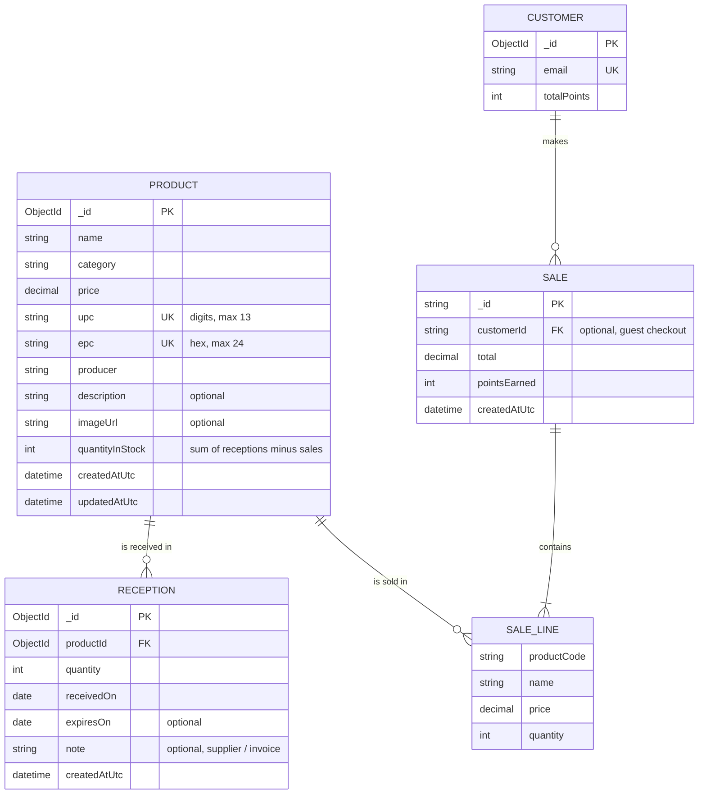

# Phase 3 — Product & inventory module

Owner: Jonathan. Covers registering, editing and deleting products, and receiving stock.

## Pages

| Page | URL | What it does |
| --- | --- | --- |
| Products | `/Products` | Product table with search (name, producer, or a scanned UPC/EPC), category filter, stock badges (green = OK, amber = 5 or fewer, red = out). Edit, Receive and Delete (with on-page confirmation) per row. |
| Add product | `/Products/Create` | Register a product once. New products start at 0 in stock and you're sent to Receive next. |
| Edit product | `/Products/Edit/{id}` | Change product details. Stock can't be typed in here; it only changes through deliveries and sales. |
| Receive stock | `/Products/Receive/{id?}` | Scan a UPC/EPC (or pick a product), enter quantity, date received, optional expiry and supplier note. Shows that product's delivery history; a delivery entered by mistake can be undone if its units haven't been sold. |

Every action shows a notification ("Product added successfully", "Received 24 × Coca-Cola. Stock is now 48.", etc.).

**Scanners:** the barcode scanner and the CF600 RFID reader (in keyboard mode) type the code and press Enter. On the product form, Enter in the UPC/EPC box moves to the next field instead of submitting early. In the search and lookup boxes, Enter searches.

## Database (MongoDB `smart_store`)

`CUSTOMER`, `SALE` and `SALE_LINE` are owned by the checkout and accounts work (Renz, Fahad) and are shown here only to make the relationships clear; they currently live in the `customers` and `demo_sales` collections.

Collections and indexes:

- `products` — unique indexes `ux_products_upc` and `ux_products_epc` (a code can't be registered twice), plus `ix_products_category`.
- `receptions` — `ix_receptions_product_receivedOn` on `(productId, receivedOn desc)`.
- Deleting a product also deletes its receptions.

Stock is stored on the product (`quantityInStock`) so checkout can read it in one lookup. It changes only through `ReceiveStockAsync` (adds) and `DecrementStockAsync` (removes, atomically, and refuses if there isn't enough).

## Integrated checkout

`StoreDemo` now injects `IProductRepository`; checkout and management load the same persistent products as `/Products`. There is no separate hardcoded catalog or stock reset on restart.

- UPC is the canonical cart and sale-line code. Manual/keyboard-scanner entry also accepts EPC, case-insensitively, and consolidates UPC/EPC aliases for the same product. Each entry adds one unit.
- **Simulate RFID scan** builds virtual physical-item tags from up to two in-stock products. Distinct virtual tags for the same product count as separate units; reading the same virtual tag again does not duplicate it. These virtual identities are not the product-level EPC stored in inventory, and no physical RFID connection is claimed.
- Checkout reloads product prices and validates quantities on the server. Approved payment reserves stock through `DecrementStockManyAsync`; a shortage restores any items already reserved. Declined attempts save a record without reserving stock.
- Receipt insertion and registered-customer loyalty increments commit together in a MongoDB transaction. Atlas or a replica set is required. One point is earned per whole dollar of an approved registered-customer purchase; guest and declined purchases earn none.
- A confirmed failed sale restores reserved inventory. An unconfirmable transaction outcome retains the reservation and instructs staff to check the receipt before retrying. Email/status-indicator failures cannot turn a committed purchase into a failed payment.
- Receipts and customer history remain available from `/Checkout`; SMTP receipt delivery is optional. `/Management` excludes declined attempts from its displayed revenue.

Delivery receiving compensates a rejected stock update by removing its history entry. Undo atomically claims the history entry so simultaneous requests cannot deduct stock twice; a rejected undo restores the entry.

**Consistency limit:** inventory reservation and the receipt/loyalty transaction are separate operations; receiving and undo also use compensating writes across documents. They are not crash-atomic transactions. Process crashes, ambiguous database responses, or failed compensation may require staff reconciliation; failure messages must not be treated as permission to retry blindly.
