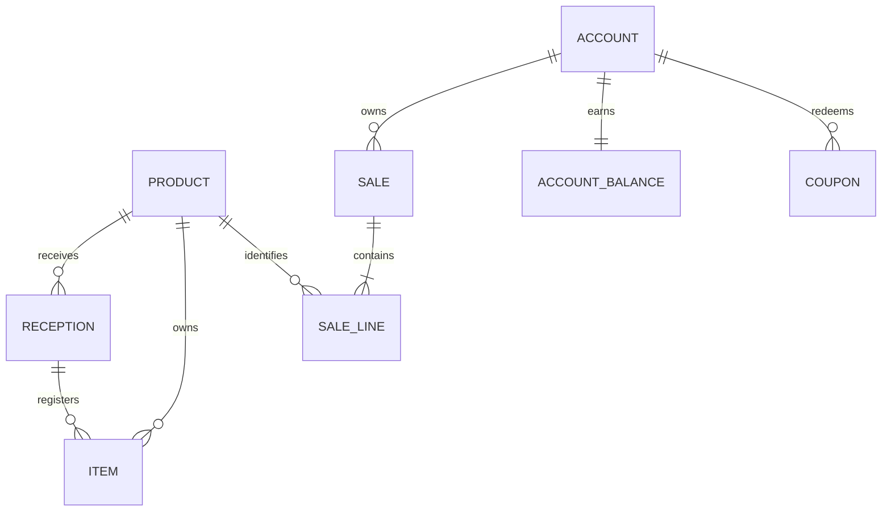

# Phase 3 — products, receiving and checkout

## Pages

| Page | Purpose |
|---|---|
| `/Products` | Staff product list, filtering, inventory counts and retirement |
| `/Products/Create` | Register a product type once with name, category, decimal price, UPC and producer |
| `/Products/Edit/{id}` | Edit descriptive fields without overwriting stock |
| `/Products/Receive/{id?}` | Dated deliveries, per-unit EPC registration, correction and delivery undo |
| `/Checkout` | Guest or optional member checkout, barcode/manual entry, explicitly paired reader, simulated payment |
| `/Management`, `/InventoryReport`, `/Reports` | Shared stock, live inventory and date-filtered sales/customer activity |
| `/Profile`, `/PurchaseHistory`, `/Spending` | Account-owned membership, points, receipts and price/spending reports |

Each operation reports success/failure. Technical setup belongs here, not in ordinary customer labels.

## Identity and relationships

**UPC** identifies a product type; an **EPC** identifies one physical tagged unit. Store UPC as text to preserve leading zeros. The assignment's UPC maximum is 13 characters and EPC maximum is 24 hexadecimal characters; do not truncate scans. Short synthetic product codes are not claims of a registered GS1 UPC.

- `products`: stable ObjectId, current UPC/name/category/price/producer, stock and nullable `archivedAtUtc`.
- `items`: EPC primary key, stable product/reception IDs, in-stock/sold state, sale reference/time and scan/guess attribution.
- `receptions`: stable product ID, newly added quantity/EPCs, date received, optional expiry/note.
- `demo_sales`: receipt/attempt identity, account ID or private guest ownership, email contact snapshot, itemized historical prices/names, totals/points/payment/mail outcome.
- Sale lines retain stable `ProductId`, original code/name/price/quantity and exact EPCs. Reports group stable identity, not today's mutable UPC.
- `store_accounts`: verified credentials, name, generated membership, immutable account ID and revocation state.
- `account_balances` and account-owned coupons: points/rewards keyed by account ID.
- The Phase 1 `customers` registry and older email-only balances/receipts are preserved separately. A new account never claims them merely by verifying the same email.

No authenticity claim is made for a manually entered EPC. Reader-origin events authenticate the bridge/session, not the physical tag.

## Receiving and stock invariants

A product is defined once and can receive many dated deliveries. Scan each unit's EPC or enter a quantity of untagged units. The saved quantity counts new tags plus untagged units, not duplicated scans.

`quantityInStock >= count(in_stock items)`; the difference is untagged stock. Receiving atomically registers tags, increments stock and inserts a delivery. A duplicate tag already in stock is skipped. A tag owned by another product or sold by a confirmed scan is rejected.

Correction of an old guessed-sold tag is allowed even when no new stock arrives: the correction commits without adding stock or a fake delivery. Barcode sales consume untagged units before guessing tagged identities. When a historical guess must move, replacement stock must have existed by that original sale's time; a later delivery cannot be retroactively sold.

Undo of a mistaken delivery is transactional and refuses units already sold. Concurrent undo cannot deduct twice. Product removal **archives** it: UPC mappings, EPCs and delivery history remain traceable and identifiers cannot silently be reassigned. Archived products are excluded from new sales/receiving but remain accessible to authorized staff.

UPC and EPC claims share collision protection, including concurrent operations. A barcode/quick-add selection cannot resolve to a different product because its digits shadow a registered tag.

## Checkout

Barcode/manual keyboard input is queued so one lookup cannot discard the next scan. A UPC adds product quantity; a registered eligible EPC adds one exact unit. Repeated EPC observations are deduplicated. The reader/cart rejects confirmed-sold or unknown units before payment.

Tagged cart entries expose their EPC so **Remove** removes the selected physical unit. Continuous inventory does not immediately re-add a deliberately removed tag. The virtual RFID button is clearly simulated and is not hardware proof.

Membership is optional. Signed-in accounts earn one point per whole dollar of an approved purchase and receive receipts at their verified account email. Guests can complete the shopping/payment workflow without a membership account. Guest receipt access remains bound to that checkout browser rather than exposing a public receipt-ID lookup.

Each logical attempt has a protected owner-bound identity. A replay returns the same result; a reused attempt with different content is rejected. Approved stock/tag/coupon/receipt/points changes share one snapshot transaction with majority commit. Declines record the attempt without changing stock/points. Email failure cannot convert a committed purchase into a failed payment or invite a duplicate sale.

An unknown commit outcome preserves its operation reference and warns against blind retry. It is not permission to issue compensating stock writes.

## Reports and legacy records

Inventory updates after purchases. Sales reports include units by product, most/least sold products, revenue, new/returning identified customers and busiest/quietest days for the chosen period. Personal receipt searches include quantities, purchase date/time, unit prices and a price-over-time diagram. Paging/aggregation is done server-side with bounded report windows.

Changing a UPC does not rewrite receipts or split new product histories. Old sale lines lacking a stable product ID retain explicit legacy-code grouping rather than being guessed onto a possibly unrelated current product.

Older email-only purchases and loyalty remain unclaimed by new accounts. Staff may inspect those records and verify an original receipt/reference plus identity independently before any authorized transfer. Never bulk-link by email; never discard the old data to make migration easier.

`--backfill-checkout` maintains supported code/index/view metadata only; it does not award legacy balances to current mailbox holders. Use a replica set/Atlas. Standalone MongoDB cannot run the required multi-document transactions.

## Verification and handoff

`tests/SmartStore.Tests/MongoTransactionIntegrationTests.cs` uses a disposable **loopback replica set**, never Atlas. It covers persistent stock/history/ownership/idempotency and rollback. `tests/checkout/checkout.test.cjs` exercises real checkout JavaScript behavior. See [README](../README.md#verification) for commands.

Before the live demonstration: receive real tagged units; scan several together through the CF600; remove a selected unit; demonstrate decline/approve, exact stock, guest/member behavior, points, a single result on resubmission, receipt email and reports. Synthetic tags and parser fixtures do not prove RF acquisition.

The earlier ownership notes identified Jonathan for inventory and Renz/Fahad for checkout/accounts. The group must confirm real final assignments in the [submission task table](../README.md#required-group-task-table).
