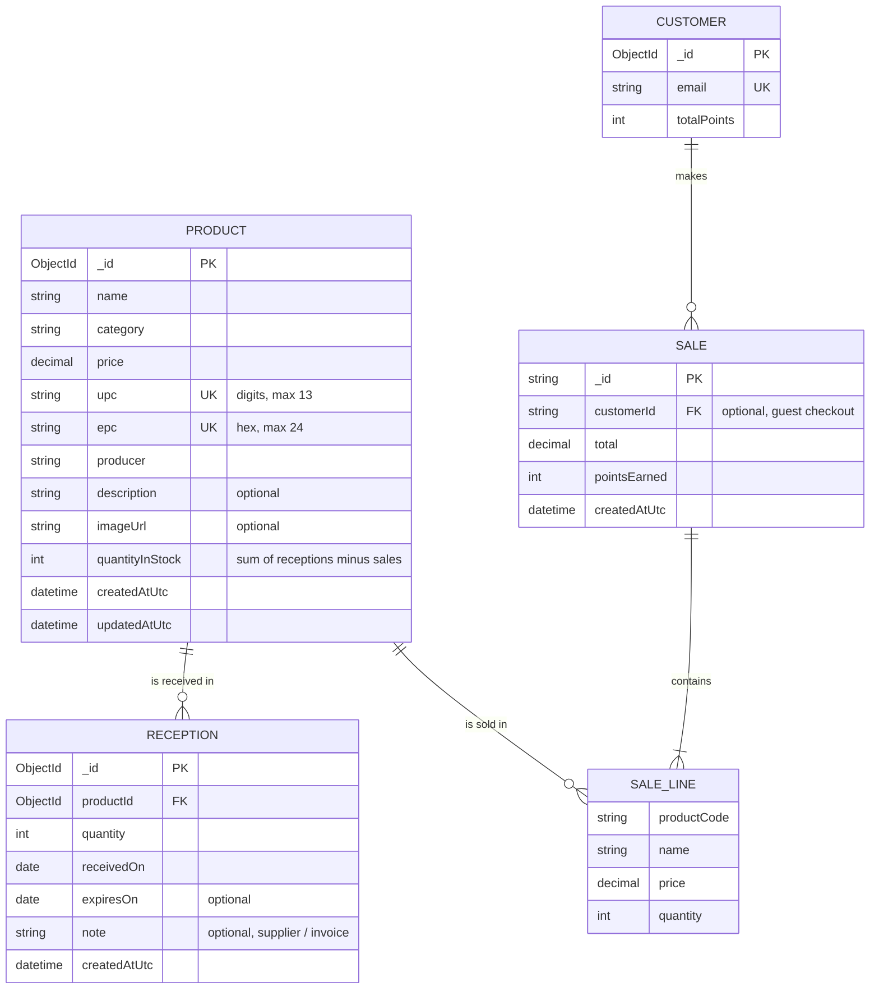

# Phase 3 — Product & inventory module

Owner: Jonathan. Covers registering, editing and deleting products, and receiving stock.

## Pages

| Page | URL | What it does |
| --- | --- | --- |
| Products | `/Products` | Product table with search (name, producer, or a scanned UPC/EPC), category filter, stock badges (green = OK, amber = 5 or fewer, red = out). Edit, Receive and Delete (with on-page confirmation) per row. |
| Add product | `/Products/Create` | Register a product once. New products start at 0 in stock and you're sent to Receive next. |
| Edit product | `/Products/Edit/{id}` | Change product details. Stock can't be typed in here; it only changes through deliveries and sales. |
| Receive stock | `/Products/Receive/{id?}` | Scan a UPC/EPC (or pick a product), enter quantity, date received, optional expiry and supplier note. Shows that product's delivery history; a delivery entered by mistake can be undone if its units haven't been sold. |

Every action shows a notification ("Product added successfully", "Received 24 × Coca-Cola. Stock is now 48.", etc.).

**Scanners:** barcode scanners and a CF600 configured for **keyboard emulation, raw EPC output and an Enter suffix** can type into a focused code box. The app does not open USB/virtual-serial devices or configure the reader. On the product form, scan one tag at a time; Enter moves to the next field rather than submitting early. Overlong UPC/EPC values are preserved for validation, not silently truncated. In search and lookup boxes, Enter searches.

## Database (MongoDB `smart_store`)

`CUSTOMER`, `SALE` and `SALE_LINE` are owned by the checkout and accounts work (Renz, Fahad) and are shown here only to make the relationships clear; they currently live in the `customers` and `demo_sales` collections.

Collections and indexes:

- `products` — unique indexes `ux_products_upc` and `ux_products_epc` (a code can't be registered twice), plus `ix_products_category`.
- `receptions` — `ix_receptions_product_receivedOn` on `(productId, receivedOn desc)`.
- Deleting a product also deletes its receptions.

Stock is stored on the product (`quantityInStock`) so checkout can read it in one lookup. It changes only through `ReceiveStockAsync` (adds) and `DecrementStockAsync` (removes, atomically, and refuses if there isn't enough).

## Integrated checkout

`StoreDemo` now injects `IProductRepository`; checkout and management load the same persistent products as `/Products`. There is no separate hardcoded catalog or stock reset on restart.

- UPC is the canonical cart and sale-line code. **Barcode / manual** entry also accepts EPC, case-insensitively, and consolidates UPC/EPC aliases for the same product. Each entry adds one unit; UPC takes precedence when an entry also matches another product's numeric EPC.
- **RFID** interprets entries strictly as EPCs, so a numeric EPC cannot accidentally select a different product with that UPC. It ignores repeated reads of an EPC for the page session, including after removing its item. Manually adding an item can explicitly restore it; reloading starts a new scan session. Failed reads are consumed so the next keyboard scan does not append to a rejected code.
- **Simulate RFID scan** builds virtual physical-item tags from up to two in-stock products. Distinct virtual tags for the same product count as separate units; reading the same virtual tag again does not duplicate it. These virtual identities are not the product-level EPC stored in inventory, and no physical RFID connection is claimed. Do not use this button as proof of physical reader integration.
- Checkout reloads product prices and validates quantities inside the same snapshot transaction as its writes. Approved payment commits **all stock deductions, receipt insertion, and registered-customer loyalty increments together**, or none. Declined attempts save a record without changing stock or points.
- Atlas or a replica set is required. One point is earned per whole dollar of an approved registered-customer purchase; guest and declined purchases earn none. UPC/EPC aliases for the same product share the per-product quantity limit.
- The driver's transaction callback retries transient conflicts with fresh attempt-local state and a stable receipt identity. If commit acknowledgement is lost, checkout checks for a majority-confirmed receipt; otherwise it reports an unknown outcome and instructs staff to check that reference before retrying. No compensating stock writes are issued. Email/status-indicator failures cannot turn a committed purchase into a failed payment.
- Receipts and customer history remain available from `/Checkout`; SMTP receipt delivery is optional. `/Management` excludes declined attempts from its displayed revenue.

Delivery receiving commits its stock increment and history entry in one transaction. Undo commits history removal and stock deduction together; insufficient stock aborts both, and simultaneous undo requests cannot deduct twice. Deleting a product and its reception history is also transactional.

Transaction reads use snapshot isolation on the primary and commits use majority write concern. Callback failures attempt abort with an independent bounded token, so cancelling an HTTP request does not also cancel rollback. Server-side abort remains best-effort during network failure; uncommitted changes are not exposed as completed operations. See [MongoDB .NET transaction semantics](https://www.mongodb.com/docs/drivers/csharp/current/crud/transactions/).

**Outcome handling:** losing a commit acknowledgement can leave the caller uncertain whether the entire transaction committed. This is not a partially saved sale or delivery. Notifications preserve operation references and warn against blind retry; a separate HTTP resubmission is not automatically deduplicated.

## Database verification

`tests/SmartStore.Tests/MongoTransactionIntegrationTests.cs` retains real-replica-set regressions for stock/history accumulation, concurrent UPC/EPC duplicates, checkout totals and loyalty, declines, UPC/EPC aliases, shortages, rejected receipt/history writes, undo, deletion, cancellation, and outsider visibility before commit. Set `SMARTSTORE_TEST_MONGODB_URI` to a local replica-set URI as shown in the README. Tests refuse remote/Atlas hosts and create a fresh GUID database per case; no real application data is used.

## CF600 reader findings

Reviewed against the supplied Phase 3 assignment and the [manufacturer's CF600 specification](https://www.chafontech.com/productinfo/1111081.html?templateId=1133605). The assignment identifies the model but is not a protocol manual; it says the SDK is supplied separately on Omnivox.

### Remaining integration gaps

- **USB/SDK and virtual-serial modes are not connected.** `Program.cs` registers no reader service; the application has no reader SDK dependency, USB/serial transport, reader discovery, or inventory command. A CF600 in those modes will not deliver scans to this app. Keyboard emulation is a separate device mode, not something a browser input automatically enables.
- **Real multi-unit RFID checkout is not represented by the data model.** `Product.Epc` and its unique index associate exactly one EPC with each product. There is no collection relating distinct physical-unit EPCs to the same product, or tracking which physical tags were sold. Two identical products with different tag EPCs cannot both resolve to that product today. The virtual demo tags bypass this missing mapping; they do not demonstrate compliance with simultaneous physical-item checkout.
- **Reader configuration matters.** The manufacturer supports both EPC and TID keyboard output. Configure raw EPC hexadecimal text (no TID, PC/CRC, prefix or metadata), with Enter after each tag. The course limits EPCs to 24 characters; longer reads are rejected, not shortened. Do not assume a tag's TID is its registered EPC.
- **Keyboard input requires focus.** A reader types into whichever field currently has focus. Keep the checkout code box focused; scanning while editing the customer email or another product field sends the characters there. USB/SDK input would need a reader-side integration instead of focus-dependent keyboard entry.

### Corrections on `fix/cf600-reader-input`

- Added an explicit keyboard-EPC path with case-insensitive, session-wide tag deduplication; barcode/manual entries still add one unit each.
- Kept seen EPCs ignored after cart removal so continued reads cannot undo a customer's removal.
- Consumed unsuccessful scans to avoid concatenating the next read with a rejected code.
- Removed UPC/EPC input truncation from registration/editing, allowing existing validation to reject the complete unsupported value instead of registering a valid-looking prefix.
- Distinguished numeric EPC lookup from UPC lookup in keyboard-EPC mode.

### Verification and hardware handoff

`tests/SmartStore.ScannerTests` contains 11 Chromium regressions covering repeated reads, UPC leading zeroes, numeric UPC/EPC collisions, failed-read recovery, removal, sequential tag reads, stock limits, simulation deduplication, and rendered-page code validation. All 11 passed during this review. Checkout-cart tests use a fixture catalog with the production JavaScript; rendered-page tests run the actual app against an unreachable local database. No reader, live store data, or physical RF operation is simulated or verified.

For a hardware session, first use the vendor tool to confirm the reader's active interface, EPC output, terminator, locally appropriate RF region, power and tag compatibility. In keyboard mode, confirm one complete EPC per line in a text editor before testing the app. Then check repeated reads of one tag, removal while the tag remains present, two registered product EPCs in succession, and an unknown tag. This is browser input verification, not evidence of an SDK-driven simultaneous inventory round. For the assignment's simultaneous physical-item workflow, the Omnivox SDK/protocol and a physical-item EPC-to-product mapping are still required.
