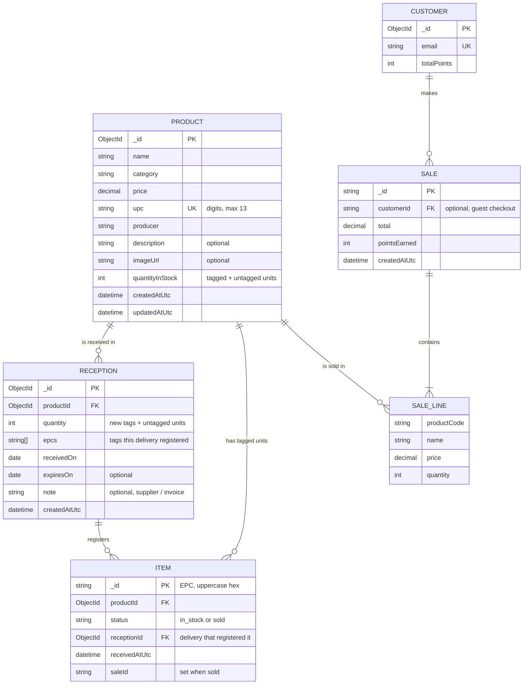

# Phase 3 — Product & inventory module

Owner: Jonathan. Covers registering, editing and deleting products, and receiving stock.

## Pages

| Page | URL | What it does |
| --- | --- | --- |
| Products | `/Products` | Product table with search (name, producer, a scanned UPC, or a unit's RFID tag), category filter, stock badges (green = OK, amber = 5 or fewer, red = out). Edit, Receive and Delete (with on-page confirmation) per row. |
| Add product | `/Products/Create` | Register a product type once, identified by its UPC. New products start at 0 in stock and you're sent to Receive next. |
| Edit product | `/Products/Edit/{id}` | Change product details. Stock can't be typed in here; it only changes through deliveries and sales. |
| Receive stock | `/Products/Receive/{id?}` | Scan the UPC (or pick a product), then scan each unit's RFID tag; every new tag is registered as one item and adds one to stock. Rescanned tags already in stock are skipped; tags of another product or already sold are refused. Products without tags are received by quantity. Also date received, optional expiry and supplier note. Shows that product's delivery history; a delivery entered by mistake can be undone (which also unregisters its tags) if its units haven't been sold. |

Every action shows a notification ("Product added successfully", "Received 24 × Coca-Cola. Stock is now 48.", etc.).

**Scanners:** the barcode scanner and the CF600 RFID reader (in keyboard mode) type the code and press Enter. On the product form, Enter in the UPC box moves to the next field instead of submitting early. In the search and lookup boxes, Enter searches. In the Receive page's tag box, each Enter starts a new line, so scan one unit after another.

## Database (MongoDB `smart_store`)

`CUSTOMER`, `SALE` and `SALE_LINE` are owned by the checkout and accounts work (Renz, Fahad) and are shown here only to make the relationships clear; they currently live in the `customers` and `demo_sales` collections.

Collections and indexes:

- `products` — unique index `ux_products_upc` (a UPC can't be registered twice), plus `ix_products_category`.
- `items` — one document per RFID-tagged unit, keyed by its EPC (so a tag can only exist once); `ix_items_product_status` on `(productId, status)`.
- `receptions` — `ix_receptions_product_receivedOn` on `(productId, receivedOn desc)`.
- Deleting a product also deletes its receptions and items.

Stock is stored on the product (`quantityInStock`) so checkout can read it in one lookup. It changes only through `ReceiveStockAsync` (adds) and `DecrementStockAsync` (removes, atomically, and refuses if there isn't enough).

## Integrated checkout

`StoreDemo` now injects `IProductRepository`; checkout and management load the same persistent products as `/Products`. There is no separate hardcoded catalog or stock reset on restart.

- UPC is the canonical cart and sale-line code. Manual/keyboard-scanner entry also accepts EPC, case-insensitively, and consolidates UPC/EPC aliases for the same product. Each entry adds one unit.
- **Simulate RFID scan** builds virtual physical-item tags from up to two in-stock products. Distinct virtual tags for the same product count as separate units; reading the same virtual tag again does not duplicate it. These virtual identities are not the product-level EPC stored in inventory, and no physical RFID connection is claimed.
- Checkout reloads product prices and validates quantities inside the same snapshot transaction as its writes. Approved payment commits **all stock deductions, receipt insertion, and registered-customer loyalty increments together**, or none. Declined attempts save a record without changing stock or points.
- Atlas or a replica set is required. One point is earned per whole dollar of an approved registered-customer purchase; guest and declined purchases earn none. UPC/EPC aliases for the same product share the per-product quantity limit.
- The driver's transaction callback retries transient conflicts with fresh attempt-local state and a stable receipt identity. If commit acknowledgement is lost, checkout checks for a majority-confirmed receipt; otherwise it reports an unknown outcome and instructs staff to check that reference before retrying. No compensating stock writes are issued. Email/status-indicator failures cannot turn a committed purchase into a failed payment.
- Receipts and customer history remain available from `/Checkout`; SMTP receipt delivery is optional. `/Management` excludes declined attempts from its displayed revenue.

Delivery receiving commits its stock increment and history entry in one transaction. Undo commits history removal and stock deduction together; insufficient stock aborts both, and simultaneous undo requests cannot deduct twice. Deleting a product and its reception history is also transactional.

Transaction reads use snapshot isolation on the primary and commits use majority write concern. Callback failures attempt abort with an independent bounded token, so cancelling an HTTP request does not also cancel rollback. Server-side abort remains best-effort during network failure; uncommitted changes are not exposed as completed operations. See [MongoDB .NET transaction semantics](https://www.mongodb.com/docs/drivers/csharp/current/crud/transactions/).

**Outcome handling:** losing a commit acknowledgement can leave the caller uncertain whether the entire transaction committed. This is not a partially saved sale or delivery. Notifications preserve operation references and warn against blind retry; a separate HTTP resubmission is not automatically deduplicated.

## Database verification

`tests/SmartStore.Tests/MongoTransactionIntegrationTests.cs` retains real-replica-set regressions for stock/history accumulation, concurrent UPC/EPC duplicates, checkout totals and loyalty, declines, UPC/EPC aliases, shortages, rejected receipt/history writes, undo, deletion, cancellation, and outsider visibility before commit. Set `SMARTSTORE_TEST_MONGODB_URI` to a local replica-set URI as shown in the README. Tests refuse remote/Atlas hosts and create a fresh GUID database per case; no real application data is used.

## UPC vs EPC

The **UPC** identifies a product type (every chair of one model shares it). The **EPC** on an RFID tag identifies one physical unit, so each tagged unit is an `items` document. `quantityInStock` counts all units; it is always at least the number of that product's `in_stock` items, and the difference is untagged stock sold by barcode.

Older databases stored one EPC on each product. On first use, the app drops `ux_products_epc` and turns each old EPC (and saved EPC alias) into an in-stock item, up to the product's current stock. Tags beyond the stock count are dropped so they can be received again. `--backfill-checkout` runs the same migration.

**Checkout hand-off:** checkout still sells through `DecrementStockAsync`, which lowers stock but leaves the item `in_stock`. To mark the exact units sold, checkout should call `SellAsync(session, productId, quantity, epcs, saleId)` inside its transaction. It marks the tags sold, refuses a tag that was already sold, and refuses barcode sales of units that carry a tag.
